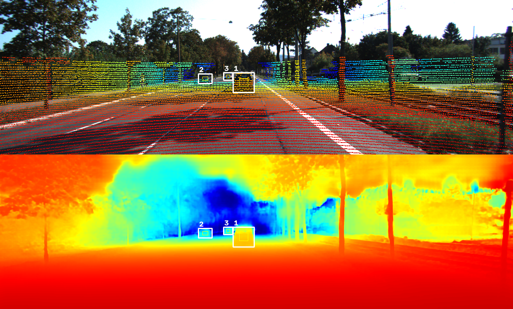
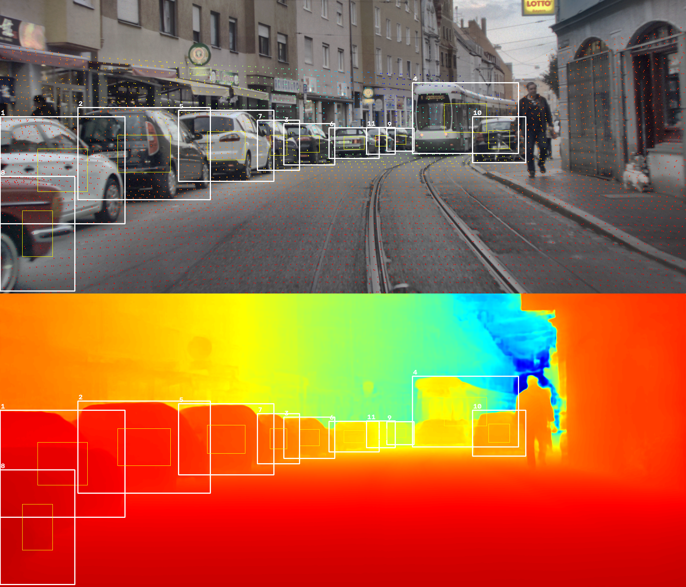
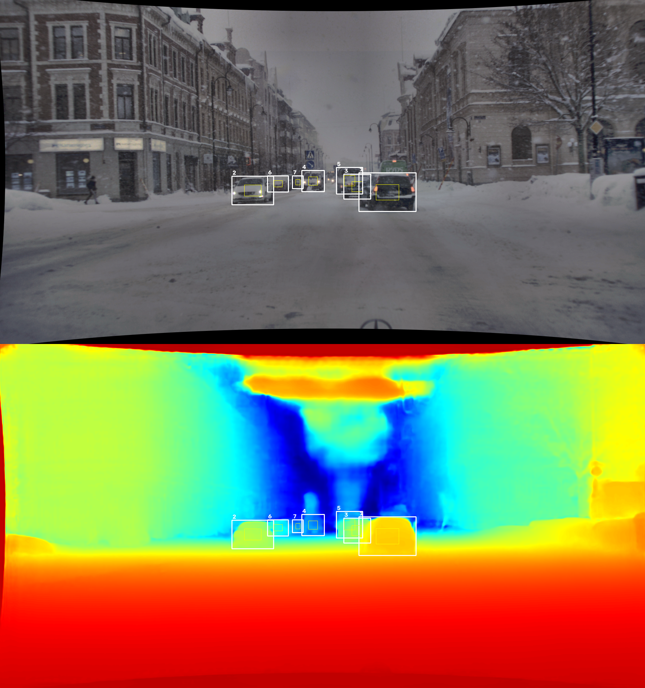
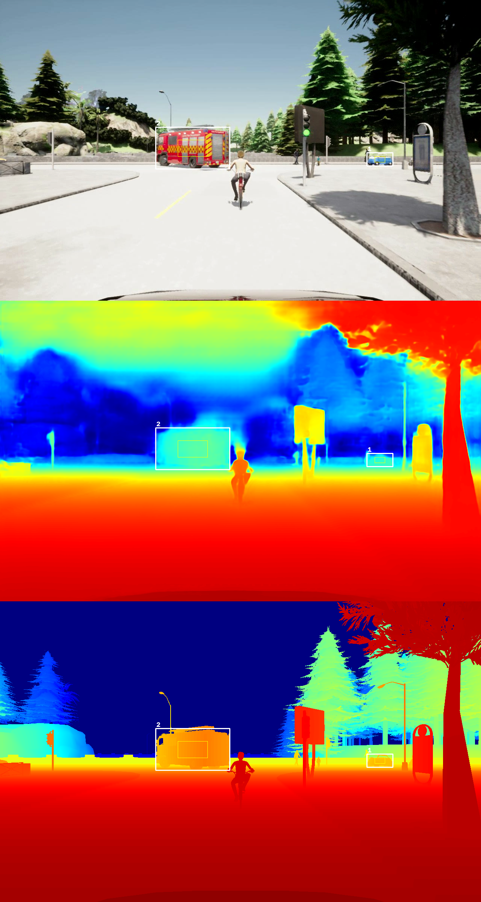
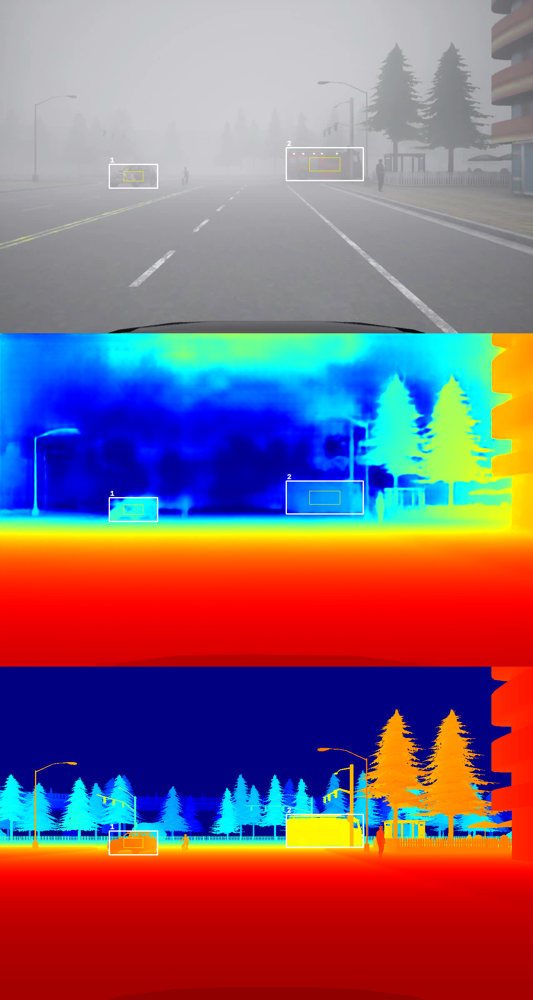

# fogrange-monocular-vehicle-distance

How far away is the car ahead, seen by a single camera, in fog, snow or rain? We compare three ways to measure it.
All of them start from the same box around a car found by YOLO:

| | Method | Distance from |
|---|---|---|
| **M1** | Geometry | the bottom edge of the box on a flat road, or the box height and a typical car height |
| **M2** | Depth network | the median of the Depth Anything V2 Metric depth map in the centre of the box |
| **M3** | Lidar | the median depth of the lidar points falling into the centre of the box |

The ground truth is the distance to the nearest face of the labelled 3D box. The main part of the project will be
fine-tuning Depth Anything V2 Metric on simulated fog and rain (SHIFT) and testing it on real bad weather (Seeing Through Fog).

## Current state

One good-weather frame from each dataset and one bad-weather frame from Seeing Through Fog and SHIFT go through all
three methods (KITTI is good weather only):

| Dataset | Weather | Frame | Image | Lidar | 3D labels |
|---|---|---|---|---|---|
| KITTI | clear | 000007, from a public repository with a few KITTI frames | yes | yes | yes |
| Seeing Through Fog | clear | the authors' example frame (split `train_clear_day`) | yes | yes | no, they need registration |
| Seeing Through Fog | snow | another example frame, `2018-02-12_15-39-23_00100` (split `snow_day`) | yes | no, needs registration | no, needs registration |
| SHIFT | clear | sequence `0094-23d0`, frame 400 (noon), from an unofficial mirror | yes | no | yes, plus the simulator depth map |
| SHIFT | heavy fog | sequence `0804-e4f8`, frame 0 (daytime) | yes | no | yes, plus the simulator depth map |

## First results

Distances in metres. GT exists only for KITTI and SHIFT here: the Seeing Through Fog labels need registration.
SHIFT has no lidar. All numbers are in [`results/one_frame/distances.csv`](results/one_frame/distances.csv).

| Frame | Vehicle | M1 road | M1 height | M2 network | M3 lidar | GT |
|---|---|---|---|---|---|---|
| KITTI, clear | car 1 | 23.2 | 22.9 | 26.2 | 23.5 | 23.4 |
| | car 2 | 39.6 | 47.4 | 49.5 | 45.9 | 45.7 |
| | car 3 | 55.0 | 60.2 | 49.7 | 58.6 | 58.5 |
| SHIFT, clear | car | 24.4 | 27.3 | 46.4 | – | 24.7 |
| | fire engine | 20.6 | 15.1 | 43.3 | – | 19.7 |
| SHIFT, heavy fog | car | 19.4 | 16.9 | 48.0 | – | 19.0 |
| | bus | 29.6 | 26.0 | 57.8 | – | 29.4 |

- On KITTI the lidar is within 0.4 m of GT; the boxes were labelled from the same lidar, so this is expected.
- The depth network roughly doubles every SHIFT distance, in clear weather and in fog alike. It was trained on
  Virtual KITTI 2 and does not know the SHIFT camera. Fine-tuning on SHIFT is meant to fix this.
- The road-plane geometry is accurate on SHIFT because its simulated town is flat.

Each picture shows the image with the YOLO boxes (lidar points in red where available), the network's depth map below,
and for SHIFT the simulator's depth map at the bottom. Near is red, 80 m and beyond is blue.

| | Clear | Bad weather |
|---|---|---|
| KITTI |  | – |
| Seeing Through Fog |  |  |
| SHIFT |  |  |

## Run

```bash
uv venv --python 3.13 .venv
```

```bash
uv pip install --python .venv/bin/python -r requirements.txt
```

```bash
.venv/bin/python scripts/fetch_samples.py
```

```bash
.venv/bin/python scripts/three_methods.py
```

The second script prints a table per frame and saves `results/one_frame/{kitti,stf,stf_snow,shift,shift_fog}.png`
and `distances.csv`. The YOLO26m weights (44 MB) and Depth Anything V2 Metric Small (99 MB) download on first use.

### More KITTI frames

The next step is an evaluation on many KITTI frames. Only the frames that are needed are read out of the official
archives (41 GB in total), half from the usual train list and half from the val list:

```bash
.venv/bin/python scripts/fetch_kitti.py 200
```

```bash
.venv/bin/python scripts/check_kitti.py
```

The first script takes about 15 minutes for 200 frames (0.6 GB). The second one checks that every frame can be read
and that lidar and labels agree, and saves a picture of five random frames to `results/kitti/check.png`.

## Course materials

The project description, the implementation plan and the first presentation (in Polish) are in [`docs/`](docs/).

## Licences

Code: AGPL-3.0 (see `LICENSE`), because Ultralytics YOLO is AGPL-3.0. The datasets are not included.
The pictures in `results/one_frame/` are built from dataset images and keep their terms, for non-commercial use only:
KITTI (Geiger et al., CC BY-NC-SA 3.0), SHIFT (Sun et al., CC BY-NC-SA 4.0) and the example frames published in the
[Seeing Through Fog repository](https://github.com/princeton-computational-imaging/SeeingThroughFog) (Bijelic et al.).
